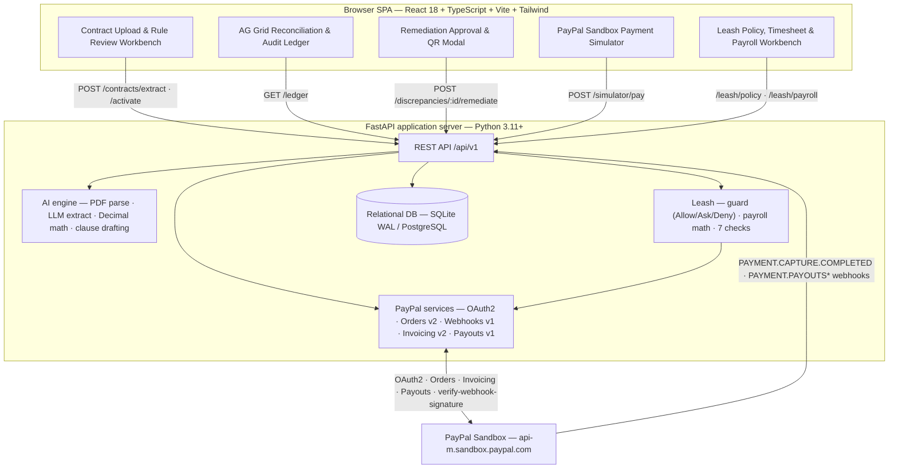

# The Financial Detective

**A contract-to-payment compliance auditor and remediation engine, built on PayPal.**

Upload a signed B2B contract → an LLM compiles it into a strict, versioned JSON rule
schema → every live PayPal capture is audited against those rules with deterministic
`Decimal` arithmetic → each breach produces a clause-cited, human-approved **PayPal
supplemental invoice** with a scannable QR code.

**Leash** — the built-in safety and payroll layer — returns Allow, Ask or Deny before
any outgoing money action, so clear-cut correction invoices go out on their own and
everything else waits for the owner. When a client pays a milestone, Leash computes the
team's pay from the timesheet, runs seven safety checks, and pays the approved lines in
one **PayPal Payouts** batch.

[](LICENSE)
[](https://www.python.org/)
[](https://fastapi.tiangolo.com/)
[](https://react.dev/)
[](https://nodejs.org/)

## Live demo

| Artifact | Link |
| --- | --- |
| Hosted application (Render, HTTPS) | `https://<service>.onrender.com` _(published at the Day 10 handoff — see [Deployment](#deployment-render))_ |
| Demo video (< 2:50) | `https://youtu.be/<id>` _(published before the submission freeze)_ |

## Contents

- [The problem](#the-problem)
- [The solution](#the-solution)
- [How it works](#how-it-works)
- [Architecture](#architecture)
- [PayPal APIs used](#paypal-apis-used)
- [AI models](#ai-models)
- [Tech stack](#tech-stack)
- [Repository layout](#repository-layout)
- [Getting started](#getting-started)
- [Configuration](#configuration)
- [API reference](#api-reference)
- [Sample contracts & fixtures](#sample-contracts--fixtures)
- [Testing](#testing)
- [Security & financial invariants](#security--financial-invariants)
- [Deployment (Render)](#deployment-render)
- [Team & ownership](#team--ownership)
- [License](#license)

## The problem

Small B2B service businesses, agencies, and freelance engineers lose an estimated
3–8% of revenue to **silent contract breaches**: clients paying a partial milestone,
deducting unagreed fees, or paying weeks past the due date without the contractual
late penalty. Catching this today means manually cross-referencing a PDF contract
against a PayPal statement — work no one does consistently.

## The solution

The Financial Detective moves the audit upstream, to the written contract, and closes
the loop on PayPal:

1. **Compile** — a signed contract (PDF/Markdown/text) is parsed and compiled into a
   strict JSON rule schema: expected milestone amounts, currency, due dates, grace
   period, late-fee rate, and the client's PayPal payer address — each with a verbatim
   clause citation.
2. **Detect** — every PayPal capture (Orders v2 + a cryptographically verified
   `PAYMENT.CAPTURE.COMPLETED` webhook) is evaluated against those rules.
3. **Remediate** — a breach produces a human-approved PayPal Invoicing v2 supplemental
   invoice for the exact `shortfall + penalty`, with the AI's clause citation in
   `detail.note` and a scannable payment QR code.
4. **Protect & pay** — Leash gates every outgoing correction invoice (Allow / Ask /
   Deny) against the owner-confirmed policy, and pays the team per funded milestone
   from the uploaded timesheet through PayPal Payouts, with one owner approval per
   batch.

The result is a static contract turned into a self-enforcing PayPal payment rail, with
money in and money out under one rule: **AI can raise suspicion; only code can say yes.**

## How it works

```
Contract upload ──▶ AI rule compiler ──▶ human review / edit ──▶ ACTIVE contract
                                                                      │
                     PayPal Orders v2 capture ◀── Client Payment Simulator (JS SDK v6)
                                    │
                 verified PAYMENT.CAPTURE.COMPLETED webhook
                                    │
        deterministic compliance engine (Decimal math)  +  LLM clause attribution
                                    │
            PENDING_APPROVAL breach ──▶ human approves ──▶ PayPal Invoicing v2
                                       (create draft → send → QR code)

            Leash guard (Allow / Ask / Deny) ──▶ correction invoice auto-send or hold
                                             └──▶ milestone payroll ──▶ PayPal Payouts
                                                  (timesheet → 7 checks → owner approval)
```

## Architecture



## PayPal APIs used

| API | Use in this project |
| --- | --- |
| **OAuth2** (`POST /v1/oauth2/token`) | Server-side bearer token with in-memory caching; refreshed when TTL < 300 s or on HTTP 401. |
| **Orders v2** (`POST /v2/checkout/orders`, `/capture`) | The Sandbox Client Payment Simulator creates and captures real orders; the capture return is the authoritative payment record. |
| **Webhooks v1** (`POST /v1/notifications/verify-webhook-signature`) | Every `PAYMENT.CAPTURE.COMPLETED` event is cryptographically verified before it can mutate state. |
| **Invoicing v2** (`POST /v2/invoicing/invoices`, `/{id}/send`, `/{id}/generate-qr-code`) | Creates, sends, and renders the QR code for the clause-cited supplemental invoice. |
| **Payouts v1** (`POST /v1/payments/payouts`, `GET /v1/payments/payouts/{batch_id}`) | Pays approved milestone payroll lines as one batch; the polling endpoint is the only source of `SUCCESS`. |
| **PayPal JS SDK v6** (`web-sdk/v6/core`) | Renders checkout in the browser via `createInstance({ clientToken })` (15-minute token); the secret never reaches the client. |

### PayPal integration rules we enforce

- **`detail.note` at draft creation.** PayPal silently ignores notes presented in the
  `/send` body, so the AI's clause citation is written to `detail.note` and
  `items[].description` when the draft is created.
- **Idempotency.** A deterministic `PayPal-Request-Id` derived from the discrepancy ID
  (`uuid5(NAMESPACE_DNS, f"{discrepancy_id}:remediate")`) plus a UNIQUE constraint on
  `paypal_capture_id` / `paypal_invoice_id` prevent duplicate charges and invoices.
- **Webhook idempotency & convergence.** `paypal_webhook_events.event_id` is UNIQUE and
  repeat deliveries short-circuit with `200`; captures are upserted on
  `paypal_capture_id` so the synchronous capture path and the asynchronous webhook converge.
- **No reporting API in the live path.** `GET /v1/reporting/transactions` can lag by up
  to 3 hours; the live flow uses Orders v2 + webhooks, and reporting is historical backfill only.
- **Unique invoice numbers.** PayPal rejects a reused `invoice_number` (422
  `DUPLICATE_INVOICE_NUMBER`), so retries create `FD-…-R<attempt>` from a persisted
  `DRAFT` row instead of blindly resending.
- **Payouts are final.** A batch `201` means `PENDING`, not paid, and batches cannot be
  voided; the guard and the owner approval both run before sending, and
  `sender_batch_id = fd-<milestone>-<run_id>` blocks double payment for 30 days.

## AI models

| Tier | Model | Role |
| --- | --- | --- |
| Primary | **Gemini 2.5 Flash** | Contract rule extraction; Leash policy compilation, timesheet column mapping, clause attribution and payment prose. |
| Secondary | **GPT-4o-mini** | Automatic fallback if the primary LLM errors or times out. |
| Tertiary | **Deterministic template** | Last-resort formatter so the demo never crashes on an LLM outage. |

The LLM extracts parameters, compiles a policy for human confirmation, maps spreadsheet
columns, and writes prose only. **It never computes money or makes a payment decision** —
`shortfall = expected_amount − captured_amount` and
`penalty = expected_amount × late_fee_rate` are computed in Python `Decimal`
(quantized to `0.01`, `ROUND_HALF_UP`), and Leash's Allow/Ask/Deny verdict comes from
`leash/guard.py`.

## Tech stack

| Layer | Technology |
| --- | --- |
| Frontend | React 18, TypeScript, Vite, Tailwind CSS, **AG Grid Community** (`ag-grid-react`), Mock Service Worker (fixtures) |
| Backend | FastAPI, Pydantic v2, SQLAlchemy, Uvicorn (Python 3.11+) |
| AI | Gemini 2.5 Flash → GPT-4o-mini → deterministic template (`pypdf` for parsing) |
| Data | SQLite with WAL (`PRAGMA journal_mode=WAL`) locally; switchable to PostgreSQL via `DATABASE_URL` |
| Payments | PayPal Orders v2, Webhooks v1, Invoicing v2, **Payouts v1**, JS SDK v6 |
| Delivery | Docker / Docker Compose, GitHub Actions, Render Blueprint (`render.yaml`) |

## Repository layout

```
financial-detective/
├── LICENSE                     # Apache-2.0 (root-level, for Devpost)
├── README.md
├── docker-compose.yml          # one-command full stack
├── render.yaml                 # Render Blueprint
├── .env.example                # safe environment template
├── .github/workflows/ci.yml    # gitleaks → ruff → mypy → pytest → tsc
├── shared/
│   ├── fixtures/               # canonical contracts + JSON mock payloads
│   │   ├── contracts/          # Acme_Standard, Globex_LateFee, Initech_MultiMilestone
│   │   ├── json/               # deterministic Detective API payloads
│   │   └── leash/              # Leash roster + timesheets (P5-owned)
│   └── openapi.json            # exported OpenAPI contract
├── scripts/                    # fixture builder, demo seed, release-gate checks
├── backend/
│   ├── Dockerfile
│   ├── requirements.txt
│   ├── app/
│   │   ├── main.py             # FastAPI entrypoint & CORS
│   │   ├── config.py           # env settings & Sandbox guardrail
│   │   ├── db/                 # SQLAlchemy models & session
│   │   ├── api/                # routers (/contracts, /ledger, /webhooks, /simulator, /discrepancies, /leash)
│   │   ├── services/paypal/    # auth, orders, invoices, webhooks, reporting, payouts
│   │   ├── schemas/contracts.py# CANONICAL PYDANTIC INTERFACE CONTRACT
│   │   ├── ai/                 # parser, extractor, compliance_math, auditor, prompts, leash/
│   │   └── leash/              # policy compile, guard, payroll math, 7 checks
│   └── tests/{unit_paypal,unit_ai,unit_leash,integration}/
└── frontend/
    ├── Dockerfile
    ├── package.json
    └── src/
        ├── types/contracts.ts  # CANONICAL TYPESCRIPT CONTRACT
        ├── api/client.ts       # typed HTTP client with mock-mode toggle
        ├── components/         # ContractWorkbench, ReconciliationGrid, RemediationModal, PaymentSimulator, Leash/
        └── __tests__/
```

## Getting started

### Prerequisites

- Docker + Docker Compose (recommended), or
- Python 3.11+, Node.js 20+, and a PayPal Developer **Sandbox** app
  (Client ID + Secret).

### One command (Docker)

```bash
git clone <repo-url> financial-detective
cd financial-detective
cp .env.example .env          # fill in PayPal Sandbox credentials
docker-compose up --build
```

- Frontend: <http://localhost:5173>
- Backend health: <http://localhost:8000/api/v1/health>

### Local development

```bash
# Backend (http://localhost:8000)
python3.11 -m venv .venv && source .venv/bin/activate
pip install -r backend/requirements.txt
uvicorn app.main:app --reload --app-dir backend

# Frontend (http://localhost:5173)
cd frontend
npm install
npm run dev
```

The frontend defaults to `VITE_USE_MOCKS=true` and serves `shared/fixtures/`
through a mock service worker (with ~400 ms simulated latency), so UI development
does not depend on a running backend.

## Configuration

All settings are read from the environment; `.env.example` is the template.

| Variable | Purpose |
| --- | --- |
| `PAYPAL_CLIENT_ID` / `PAYPAL_CLIENT_SECRET` | Sandbox app credentials (server-side only; never exposed to the browser). |
| `PAYPAL_WEBHOOK_ID` | Webhook ID used to verify `PAYMENT.CAPTURE.COMPLETED` and `PAYMENT.PAYOUTS*` signatures. |
| `PAYPAL_API_BASE_URL` | Must equal `https://api-m.sandbox.paypal.com` exactly; startup fails otherwise. |
| `DATABASE_URL` | SQLite (default) or PostgreSQL connection string. |
| `DEMO_KEY` | 24+ character secret required in `X-Demo-Key` on every write (except the PayPal webhook). |
| `CORS_ORIGINS` | Comma-separated allowed browser origins. |
| `LEASH_ENABLED` | Enables the Leash guard; `false` turns every outgoing action into Ask. |
| `PAYOUTS_POLL_SECONDS` / `PAYOUTS_POLL_MAX_SECONDS` | Payouts status polling cadence and ceiling (default 10 s / 120 s). |
| `SEED_DEMO_DATA` | Seeds the demo contract, ledger and Leash roster on startup. |
| `LOG_LEVEL` | Structured application log level. |
| `GEMINI_API_KEY` / `OPENAI_API_KEY` | LLM providers for extraction, policy compilation and drafting. |
| `AI_PRIMARY_MODEL` / `AI_FALLBACK_MODEL` | Model IDs; default `gemini-2.5-flash` → `gpt-4o-mini`. |
| `AI_TIMEOUT_SECONDS` | Per-call LLM budget (default 20 s). |
| `VITE_USE_MOCKS` / `VITE_API_BASE_URL` | Frontend mock toggle and backend base URL (public values only). |

## API reference

All routes are under `/api/v1`.

| Method | Path | Purpose |
| --- | --- | --- |
| `POST` | `/contracts/extract` | Upload a contract; returns the compiled rules and a `DRAFT` contract. |
| `POST` | `/contracts/{contract_id}/activate` | Lock human-reviewed terms and switch the contract to `ACTIVE`. |
| `POST` | `/simulator/pay` | Create + capture a real Sandbox order for the demo simulator. |
| `GET` | `/ledger` | Unified dataset for the reconciliation dashboard (summary + rows). |
| `POST` | `/discrepancies/{id}/remediate` | Human-approved Invoicing v2 remediation (create → send → QR). |
| `POST` | `/webhooks/paypal` | Verified PayPal webhook receiver (signature only). |
| `GET` / `POST` | `/leash/policy` | Read or compile the owner-confirmed Leash policy. |
| `GET` | `/leash/decisions` | Decision log (Allow / Ask / Deny with reasons). |
| `GET` / `POST` / `PATCH` | `/leash/team` | Team roster for payroll recipients. |
| `POST` | `/leash/timesheets` | Upload a timesheet; `POST /leash/timesheets/{id}/mapping` confirms columns. |
| `POST` / `GET` | `/leash/payroll/runs` | Create or list payroll runs for funded milestones. |
| `PATCH` | `/leash/payroll/runs/{run_id}/lines/{line_id}` | Owner edit of an included line. |
| `POST` | `/leash/payroll/runs/{run_id}/send` | One approval per batch; `409` while any Ask is unresolved. |
| `GET` | `/leash/ledger/margin` | Margin view (cents-based totals). |
| `POST` | `/demo/reset` | Reseed demo data with fresh run IDs. |
| `GET` | `/health` | Liveness + Sandbox connectivity. |

Every write requires the `X-Demo-Key` header (Appendix A.6); the PayPal webhook is the
only exception. The key is distributed via Devpost and never bundled into the frontend.

The canonical request/response shapes live in
[`backend/app/schemas/contracts.py`](backend/app/schemas/contracts.py) and
[`frontend/src/types/contracts.ts`](frontend/src/types/contracts.ts).

### Status model

Two orthogonal dimensions, never conflated:

- **`DiscrepancyType`** — the immutable audit reason:
  `COMPLIANT`, `UNDERPAID`, `LATE_PAYMENT`, `UNDERPAID_AND_LATE`, `CURRENCY_MISMATCH`.
- **`DiscrepancyStatus`** — the mutable remediation lifecycle:
  `NONE`, `PENDING_APPROVAL`, `BLOCKED`, `REMEDIATED`.

Remediation changes only the status; the original reason is preserved. `BLOCKED` is set
when Leash returns Deny for the outgoing correction; the DB additionally tracks internal
lifecycle states (`OPEN`, `SEND_FAILED`, `RECOVERED`, `DISMISSED`) that never leak into
the API enum.

## Sample contracts & fixtures

| Contract | Scenario exercised |
| --- | --- |
| `Acme_Standard.pdf` | `$1,000.00` milestone paid `$850.00`, five days late → **UNDERPAID_AND_LATE** ($150.00 + $50.00 = $200.00). |
| `Globex_LateFee.pdf` | Full `$2,500.00` paid after a strict (no-grace) due date → **LATE_PAYMENT** ($175.00). |
| `Initech_MultiMilestone.pdf` | Three milestones: **COMPLIANT** + **UNDERPAID** + pending. |

Deterministic JSON payloads for every endpoint live in `shared/fixtures/json/`; Leash
roster/timesheet fixtures live in `shared/fixtures/leash/` (owned by P5). See
[`shared/fixtures/README.md`](shared/fixtures/README.md) for the full matrix.

## Testing

```bash
# Backend
ruff check . && mypy app
pytest backend/tests/unit_paypal      # P1
pytest backend/tests/unit_ai          # P2
pytest backend/tests/unit_leash       # P5
pytest backend/tests/integration      # P4 end-to-end / release gates

# Frontend
npm run build && npx tsc --noEmit && npx eslint .

# Security
gitleaks detect --source . -v
```

CI runs, in order: **gitleaks → ruff → mypy → pytest → tsc**.

The test suite covers OAuth refresh, the production-URL guardrail, extraction accuracy
across the three fixtures, deterministic cent math, adversarial prompt injection,
LLM-outage fallback, webhook forgery rejection, duplicate/out-of-order idempotency,
live Sandbox invoicing, the AG Grid UI flow, a clean-room full-stack journey, and the
Leash safety gates (no silent Deny, `409` on unresolved Ask, duplicate-batch rejection).

## Security & financial invariants

- **Authoritative state only** from a `COMPLETED` `POST /v2/checkout/orders/{id}/capture`,
  a `SUCCESS` `verify-webhook-signature`, or a Payouts item status `SUCCESS`. The
  browser, polling optimism and the LLM are never trusted for money.
- **Decimal only.** Money is `Decimal` quantized to `0.01` with `ROUND_HALF_UP`;
  `float` is banned on financial paths, and payout margins are totaled in cents.
- **AI never computes money or decisions.** `compliance_math.py` and
  `leash/payroll/calculate.py` own all shortfall, penalty, payroll and margin totals;
  `leash/guard.py` owns the Allow/Ask/Deny verdict. AI can raise suspicion; only code
  can say yes.
- **Prompt-injection defense.** Payer notes, contract text and timesheet cells are
  wrapped as passive `<untrusted_input>` data; decisions never read model output.
- **Human-in-the-loop, policy-driven.** Correction invoices auto-send only when the
  owner-confirmed policy returns Allow (default G-01: ≤ `$250.00`, confidence ≥ `0.90`,
  clause quoted); otherwise `confirm_send: true` is required. Payroll batches are
  **never** auto-sent — one owner approval per batch and `POST …/send` returns `409`
  while any Ask is unresolved.
- **Double-pay guard.** `sender_batch_id = fd-<milestone>-<run_id>` is reused by PayPal
  as its idempotency key for 30 days; a demo reset generates fresh run IDs.
- **No prod bypass.** `/webhooks/paypal` has zero signature-bypass flags in every
  environment and tests use mocked PayPal transports. Every write requires
  `X-Demo-Key`, compared with `hmac.compare_digest`.
- **SSRF guard.** The `PAYPAL-CERT-URL` certificate is fetched only after validating a
  `*.paypal.com` hostname, and is cached in memory with a TTL.
- **Secrets.** `.env` is git-ignored; only `.env.example` placeholders are committed;
  gitleaks runs in CI.

## Deployment (Render)

The stack deploys from the declarative `render.yaml` Blueprint: `fd-api` (FastAPI +
webhook listener), `fd-web` (static React build) and `fd-db` (database). The public
HTTPS webhook endpoint (`https://fd-api.onrender.com/api/v1/webhooks/paypal`) is
registered in the PayPal Developer Dashboard to obtain `PAYPAL_WEBHOOK_ID`.

Six gates block recording and submission:

1. No mocked PayPal on the production path.
2. Math and idempotency tests green (TST-05/06/09/10).
3. Zero leaked secrets (gitleaks clean).
4. Root Apache-2.0 license plus a clean `docker-compose up --build`.
5. Live Render HTTPS health check (TST-12).
6. Leash safety green (TST-13/14/15/20/21/22/24).

## Team & ownership

| Person | Scope |
| --- | --- |
| **P1 · Hassan** | Backend & PayPal — FastAPI, persistence, OAuth2, Orders v2, Webhooks v1, Invoicing v2. |
| **P2 · Yassin** | AI & compliance — parsing, LLM extraction and policy compilation, clause drafting. |
| **P3 · Moamen** | Frontend & AG Grid — React workstation, reconciliation ledger, simulator, QR modal. |
| **P4 · Ahmed** | Integration, QA, security & submission — canonical contracts, fixtures, E2E harness, Docker/Render, CI, demo video. |
| **P5 · Nour** | Leash — guard, payroll math, Payouts v1 integration, timesheet mapping, Leash UI. |

Ownership boundaries are strict; `backend/app/schemas/contracts.py` and
`frontend/src/types/contracts.ts` may only change through a P4-reviewed pull request
with the affected consumers.

## License

Released under the [Apache License 2.0](LICENSE).

## Acknowledgements

Built for the **PayPal AI Hackathon**. Thanks to the PayPal Developer team for the
Sandbox APIs and AI Toolkit best-practices guidance, to **AG Grid** for the
reconciliation workbench, and to **Render** for hosting.
