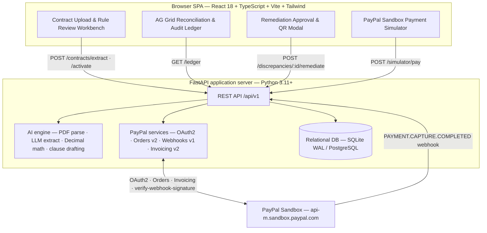

# The Financial Detective

**A contract-to-payment compliance auditor and remediation engine, built on PayPal.**

Upload a signed B2B contract → an LLM compiles it into a strict, versioned JSON rule
schema → every live PayPal capture is audited against those rules with deterministic
`Decimal` arithmetic → each breach produces a clause-cited, human-approved **PayPal
supplemental invoice** with a scannable QR code.

[](LICENSE)
[](https://www.python.org/)
[](https://fastapi.tiangolo.com/)
[](https://react.dev/)
[](https://nodejs.org/)

## Live demo

| Artifact | Link |
| --- | --- |
| Hosted application (Render, HTTPS) | `https://<service>.onrender.com` _(published at the Day 10 handoff — see [Deployment](#deployment-render))_ |
| Demo video (< 2:50) | `https://youtu.be/<id>` _(published before the submission freeze)_ |

## Contents

- [The problem](#the-problem)
- [The solution](#the-solution)
- [How it works](#how-it-works)
- [Architecture](#architecture)
- [PayPal APIs used](#paypal-apis-used)
- [AI models](#ai-models)
- [Tech stack](#tech-stack)
- [Repository layout](#repository-layout)
- [Getting started](#getting-started)
- [Configuration](#configuration)
- [API reference](#api-reference)
- [Sample contracts & fixtures](#sample-contracts--fixtures)
- [Testing](#testing)
- [Security & financial invariants](#security--financial-invariants)
- [Deployment (Render)](#deployment-render)
- [Team & ownership](#team--ownership)
- [License](#license)

## The problem

Small B2B service businesses, agencies, and freelance engineers lose an estimated
3–8% of revenue to **silent contract breaches**: clients paying a partial milestone,
deducting unagreed fees, or paying weeks past the due date without the contractual
late penalty. Catching this today means manually cross-referencing a PDF contract
against a PayPal statement — work no one does consistently.

## The solution

The Financial Detective moves the audit upstream, to the written contract, and closes
the loop on PayPal:

1. **Compile** — a signed contract (PDF/Markdown/text) is parsed and compiled into a
   strict JSON rule schema: expected milestone amounts, currency, due dates, grace
   period, late-fee rate, and the client's PayPal payer address — each with a verbatim
   clause citation.
2. **Detect** — every PayPal capture (Orders v2 + a cryptographically verified
   `PAYMENT.CAPTURE.COMPLETED` webhook) is evaluated against those rules.
3. **Remediate** — a breach produces a human-approved PayPal Invoicing v2 supplemental
   invoice for the exact `shortfall + penalty`, with the AI's clause citation in
   `detail.note` and a scannable payment QR code.

The result is a static contract turned into a self-enforcing PayPal payment rail.

## How it works

```
Contract upload ──▶ AI rule compiler ──▶ human review / edit ──▶ ACTIVE contract
                                                                      │
                     PayPal Orders v2 capture ◀── Client Payment Simulator (JS SDK v6)
                                    │
                 verified PAYMENT.CAPTURE.COMPLETED webhook
                                    │
        deterministic compliance engine (Decimal math)  +  LLM clause attribution
                                    │
            PENDING_APPROVAL breach ──▶ human approves ──▶ PayPal Invoicing v2
                                       (create draft → send → QR code)
```

## Architecture



## PayPal APIs used

| API | Use in this project |
| --- | --- |
| **OAuth2** (`POST /v1/oauth2/token`) | Server-side bearer token with in-memory caching; refreshed when TTL < 300 s or on HTTP 401. |
| **Orders v2** (`POST /v2/checkout/orders`, `/capture`) | The Sandbox Client Payment Simulator creates and captures real orders; the capture return is the authoritative payment record. |
| **Webhooks v1** (`POST /v1/notifications/verify-webhook-signature`) | Every `PAYMENT.CAPTURE.COMPLETED` event is cryptographically verified before it can mutate state. |
| **Invoicing v2** (`POST /v2/invoicing/invoices`, `/{id}/send`, `/{id}/generate-qr-code`) | Creates, sends, and renders the QR code for the clause-cited supplemental invoice. |
| **PayPal JS SDK v6** (`web-sdk/v6/core`) | Renders checkout in the browser via `createInstance({ clientToken })` (15-minute token); the secret never reaches the client. |

### PayPal integration rules we enforce

- **`detail.note` at draft creation.** PayPal silently ignores notes presented in the
  `/send` body, so the AI's clause citation is written to `detail.note` and
  `items[].description` when the draft is created.
- **Idempotency.** A deterministic `PayPal-Request-Id` derived from the discrepancy ID
  (`uuid5(NAMESPACE_DNS, f"{discrepancy_id}:remediate")`) plus a UNIQUE constraint on
  `paypal_capture_id` / `paypal_invoice_id` prevent duplicate charges and invoices.
- **Webhook idempotency & convergence.** `paypal_webhook_events.event_id` is UNIQUE and
  repeat deliveries short-circuit with `200`; captures are upserted on
  `paypal_capture_id` so the synchronous capture path and the asynchronous webhook converge.
- **No reporting API in the live path.** `GET /v1/reporting/transactions` can lag by up
  to 3 hours; the live flow uses Orders v2 + webhooks, and reporting is historical backfill only.

## AI models

| Tier | Model | Role |
| --- | --- | --- |
| Primary | **Gemini 2.5 Flash** | Contract rule extraction; clause attribution and invoice memo prose. |
| Secondary | **GPT-4o-mini** | Automatic fallback if the primary LLM errors or times out. |
| Tertiary | **Deterministic template** | Last-resort formatter so the demo never crashes on an LLM outage. |

The LLM extracts parameters and writes prose only. **It never computes money** —
`shortfall = expected_amount − captured_amount` and
`penalty = expected_amount × late_fee_rate` are computed in Python `Decimal`
(quantized to `0.01`, `ROUND_HALF_UP`).

## Tech stack

| Layer | Technology |
| --- | --- |
| Frontend | React 18, TypeScript, Vite, Tailwind CSS, **AG Grid Community** (`ag-grid-react`), Mock Service Worker (fixtures) |
| Backend | FastAPI, Pydantic v2, SQLAlchemy, Uvicorn (Python 3.11+) |
| AI | Gemini 2.5 Flash → GPT-4o-mini → deterministic template (`pypdf` for parsing) |
| Data | SQLite with WAL (`PRAGMA journal_mode=WAL`) locally; switchable to PostgreSQL via `DATABASE_URL` |
| Payments | PayPal Orders v2, Webhooks v1, Invoicing v2, JS SDK v6 |
| Delivery | Docker / Docker Compose, GitHub Actions, Render Blueprint (`render.yaml`) |

## Repository layout

```
financial-detective/
├── LICENSE                     # Apache-2.0 (root-level, for Devpost)
├── README.md
├── docker-compose.yml          # one-command full stack
├── render.yaml                 # Render Blueprint
├── .env.example                # safe environment template
├── .github/workflows/ci.yml    # gitleaks → ruff → mypy → pytest → tsc
├── shared/
│   ├── fixtures/               # canonical contracts + JSON mock payloads
│   │   ├── contracts/          # Acme_Standard, Globex_LateFee, Initech_MultiMilestone
│   │   └── json/               # deterministic API payloads
│   └── openapi.json            # exported OpenAPI contract
├── backend/
│   ├── Dockerfile
│   ├── requirements.txt
│   ├── app/
│   │   ├── main.py             # FastAPI entrypoint & CORS
│   │   ├── config.py           # env settings & Sandbox guardrail
│   │   ├── db/                 # SQLAlchemy models & session
│   │   ├── api/                # routers (/contracts, /ledger, /webhooks, /simulator, /discrepancies)
│   │   ├── services/paypal/    # auth, orders, invoices, webhooks, reporting
│   │   ├── schemas/contracts.py# CANONICAL PYDANTIC INTERFACE CONTRACT
│   │   └── ai/                 # parser, extractor, compliance_math, auditor, prompts
│   └── tests/{unit_paypal,unit_ai,integration}/
└── frontend/
    ├── Dockerfile
    ├── package.json
    └── src/
        ├── types/contracts.ts  # CANONICAL TYPESCRIPT CONTRACT
        ├── api/client.ts       # typed HTTP client with mock-mode toggle
        ├── components/         # ContractWorkbench, ReconciliationGrid, RemediationModal, PaymentSimulator
        └── __tests__/
```

## Getting started

### Prerequisites

- Docker + Docker Compose (recommended), or
- Python 3.11+, Node.js 20+, and a PayPal Developer **Sandbox** app
  (Client ID + Secret).

### One command (Docker)

```bash
git clone <repo-url> financial-detective
cd financial-detective
cp .env.example .env          # fill in PayPal Sandbox credentials
docker-compose up --build
```

- Frontend: <http://localhost:5173>
- Backend health: <http://localhost:8000/api/v1/health>

### Local development

```bash
# Backend (http://localhost:8000)
python3.11 -m venv .venv && source .venv/bin/activate
pip install -r backend/requirements.txt
uvicorn app.main:app --reload --app-dir backend

# Frontend (http://localhost:5173)
cd frontend
npm install
npm run dev
```

The frontend defaults to `VITE_USE_MOCKS=true` and serves `shared/fixtures/`
through a mock service worker (with ~400 ms simulated latency), so UI development
does not depend on a running backend.

## Configuration

All settings are read from the environment; `.env.example` is the template.

| Variable | Purpose |
| --- | --- |
| `PAYPAL_CLIENT_ID` / `PAYPAL_CLIENT_SECRET` | Sandbox app credentials (server-side only; never exposed to the browser). |
| `PAYPAL_WEBHOOK_ID` | Webhook ID used to verify `PAYMENT.CAPTURE.COMPLETED` signatures. |
| `PAYPAL_API_BASE_URL` | Must contain `sandbox.paypal.com`; startup fails otherwise. |
| `DATABASE_URL` | SQLite (default) or PostgreSQL connection string. |
| `ENV` | `local_test` enables the test-only dev routes. |
| `GEMINI_API_KEY` / `OPENAI_API_KEY` | LLM providers for extraction and drafting. |
| `VITE_USE_MOCKS` / `VITE_API_BASE_URL` | Frontend mock toggle and backend base URL. |

## API reference

All routes are under `/api/v1`.

| Method | Path | Purpose |
| --- | --- | --- |
| `POST` | `/contracts/extract` | Upload a contract; returns the compiled rules and a `DRAFT` contract. |
| `POST` | `/contracts/{contract_id}/activate` | Lock human-reviewed terms and switch the contract to `ACTIVE`. |
| `POST` | `/simulator/pay` | Create + capture a real Sandbox order for the demo simulator. |
| `GET` | `/ledger` | Unified dataset for the reconciliation dashboard (summary + rows). |
| `POST` | `/discrepancies/{id}/remediate` | Human-approved Invoicing v2 remediation (create → send → QR). |
| `POST` | `/webhooks/paypal` | Verified PayPal webhook receiver. |
| `POST` | `/discrepancies/{id}/remind` | _Post-MVP._ Send an Invoicing v2 reminder. |
| `GET` | `/health` | Liveness + Sandbox connectivity. |
| `POST` | `/dev/simulate-webhook` | _Test-only._ Mounted solely when `ENV == "local_test"`. |

The canonical request/response shapes live in
[`backend/app/schemas/contracts.py`](backend/app/schemas/contracts.py) and
[`frontend/src/types/contracts.ts`](frontend/src/types/contracts.ts).

### Status model

Two orthogonal dimensions, never conflated:

- **`DiscrepancyType`** — the immutable audit reason:
  `COMPLIANT`, `UNDERPAID`, `LATE_PAYMENT`, `UNDERPAID_AND_LATE`, `CURRENCY_MISMATCH`.
- **`DiscrepancyStatus`** — the mutable remediation lifecycle:
  `NONE`, `PENDING_APPROVAL`, `REMEDIATED`.

Remediation changes only the status; the original reason is preserved.

## Sample contracts & fixtures

| Contract | Scenario exercised |
| --- | --- |
| `Acme_Standard.pdf` | `$1,000.00` milestone paid `$850.00`, five days late → **UNDERPAID_AND_LATE** ($150.00 + $50.00 = $200.00). |
| `Globex_LateFee.pdf` | Full `$2,500.00` paid after a strict (no-grace) due date → **LATE_PAYMENT** ($175.00). |
| `Initech_MultiMilestone.pdf` | Three milestones: **COMPLIANT** + **UNDERPAID** + pending. |

Deterministic JSON payloads for every endpoint live in `shared/fixtures/json/`; see
[`shared/fixtures/README.md`](shared/fixtures/README.md) for the full matrix.

## Testing

```bash
# Backend
ruff check . && ruff format --check . && mypy app
pytest backend/tests/unit_paypal      # P1
pytest backend/tests/unit_ai          # P2
pytest backend/tests/integration      # P4 end-to-end / release gates

# Frontend
npm run build && npx tsc --noEmit && npx eslint .

# Security
gitleaks detect --source . -v
```

CI runs, in order: **gitleaks → ruff → mypy → pytest → tsc**.

The test suite covers OAuth refresh, the production-URL guardrail, extraction accuracy
across the three fixtures, deterministic cent math, adversarial prompt injection,
LLM-outage fallback, webhook forgery rejection, duplicate/out-of-order idempotency,
live Sandbox invoicing, the AG Grid UI flow, and a clean-room full-stack journey.

## Security & financial invariants

- **Authoritative state only** from a `COMPLETED` `POST /v2/checkout/orders/{id}/capture`
  or a `SUCCESS` `verify-webhook-signature`. The browser and the LLM are never trusted
  for money or compliance.
- **Decimal only.** Money is `Decimal` quantized to `0.01` with `ROUND_HALF_UP`;
  `float` is banned on financial paths.
- **AI never computes money.** `compliance_math.py` owns all shortfall/penalty totals.
- **Prompt-injection defense.** Payer notes and contract text are wrapped as passive
  `<untrusted_*>` data; compliance status is deterministic.
- **Human-in-the-loop.** Discrepancies stay `PENDING_APPROVAL` until an explicit
  `confirm_send: true` remediation call.
- **No prod bypass.** `/webhooks/paypal` has zero signature-bypass flags; synthetic
  webhook testing is confined to `/dev/simulate-webhook` under `ENV == "local_test"`.
- **SSRF guard.** The `PAYPAL-CERT-URL` certificate is fetched only after validating a
  `*.paypal.com` hostname, and is cached in memory with a TTL.
- **Secrets.** `.env` is git-ignored; only `.env.example` placeholders are committed;
  gitleaks runs in CI.

## Deployment (Render)

The stack deploys from the declarative `render.yaml` Blueprint: the
FastAPI service (with the webhook listener) and the static React build. The public
HTTPS webhook endpoint (`https://<service>.onrender.com/api/v1/webhooks/paypal`) is
registered in the PayPal Developer Dashboard to obtain `PAYPAL_WEBHOOK_ID`.

Release gates block recording and submission: no mocked PayPal on the production path;
math and idempotency tests green; zero leaked secrets and dev routes disabled; root
Apache-2.0 license plus a clean `docker-compose up --build`; and a live Render HTTPS
health check.

## Team & ownership

| Person | Scope |
| --- | --- |
| **P1** | Backend & PayPal — FastAPI, persistence, OAuth2, Orders v2, Webhooks v1, Invoicing v2. |
| **P2** | AI & compliance — parsing, LLM extraction, `Decimal` math, clause drafting. |
| **P3** | Frontend & AG Grid — React workstation, reconciliation ledger, simulator, QR modal. |
| **P4** | Integration, QA, security & submission — canonical contracts, fixtures, E2E harness, Docker/Render, CI, demo video. |

Ownership boundaries are strict; `backend/app/schemas/contracts.py` and
`frontend/src/types/contracts.ts` may only change through a P4-reviewed pull request
with the affected consumers.

## License

Released under the [Apache License 2.0](LICENSE).

## Acknowledgements

Built for the **PayPal AI Hackathon**. Thanks to the PayPal Developer team for the
Sandbox APIs and AI Toolkit best-practices guidance, to **AG Grid** for the
reconciliation workbench, and to **Render** for hosting.
